# LesCracks architecture

How the platform is built **today** (October 2026, release after V40), drawn from the code
rather than from intentions. Every diagram is Mermaid, so GitHub renders it and a pull request
that changes the system can change its picture in the same diff.

- The rules every change must follow: [`.claude/skills/design-patterns/SKILL.md`](../../.claude/skills/design-patterns/SKILL.md)
- How well the code follows them, measured: [design-audit.md](design-audit.md)
- The complete database schema: [database.md](database.md), [schema.sql](schema.sql)

Contents

1. [System context](#1-system-context)
2. [Containers and deployment](#2-containers-and-deployment)
3. [How a request travels](#3-how-a-request-travels)
4. [Backend modules](#4-backend-modules)
5. [Inside a module: ports and adapters](#5-inside-a-module-ports-and-adapters)
6. [Authentication](#6-authentication)
7. [Key flows](#7-key-flows)
8. [Data model](#8-data-model)
9. [Frontend](#9-frontend)
10. [Delivery pipeline](#10-delivery-pipeline)
11. [Observability](#11-observability)

---

## 1. System context

Who uses the platform and which outside systems it depends on.

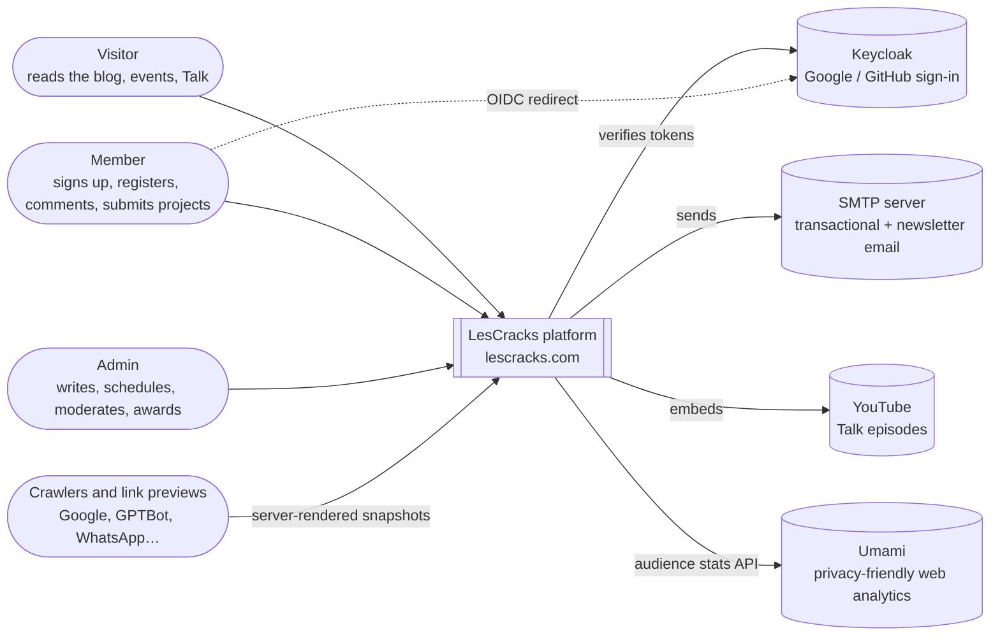

## 2. Containers and deployment

One VPS, one Docker Compose file per environment (`docker-compose.prod.yml`), Traefik in front
(TLS via Let's Encrypt). Everything except the routed services lives on the private
`lescracks-internal` network.

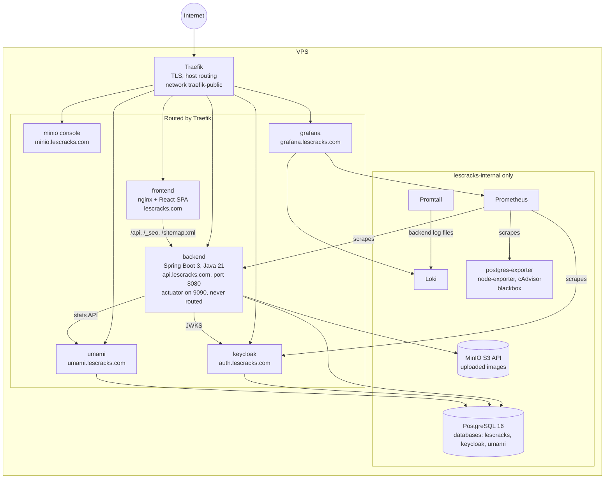

| Container | Image tag | State it owns |
| --- | --- | --- |
| frontend, backend | `brandoniscoding/*:${IMAGE_TAG}` (release version) | none |
| postgres | `postgres:16-alpine` | volume `lescracks_postgres_data` |
| minio | `minio/minio:latest` (unpinned, see audit) | volume `lescracks_minio_data` |
| keycloak | `quay.io/keycloak/keycloak:26.0` | its own database in postgres |
| prometheus, loki, grafana | pinned versions | their volumes |

## 3. How a request travels

The SPA calls the API **on its own origin** (`/api`, `ENV.API_BASE_URL`), so the session cookie
is first-party. nginx also decides, per user agent, whether a page is served as the SPA or as a
server-rendered snapshot.

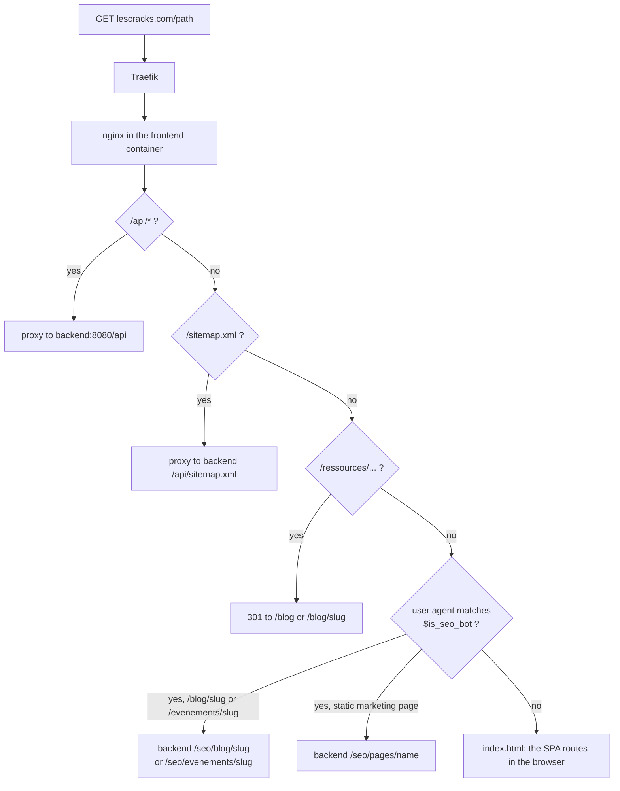

## 4. Backend modules

One package per business capability (`backend/src/main/java/com/brandonkamga/lescracks/`).
The arrows are **real compile-time dependencies**, measured from the imports; `shared` is left
out because every module uses it. The graph has no cycle, and `ArchitectureTest` keeps it so.

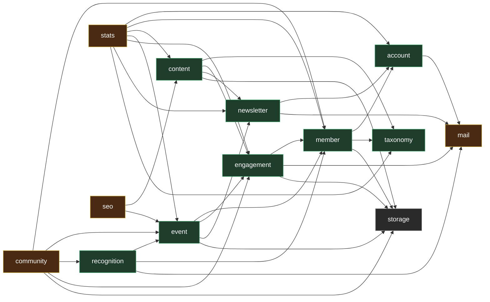

Green: on the target skeleton and checked by `ArchitectureTest`. Brown: not migrated yet
(`community`, `stats` → `analytics`, `mail` → `notification`, `seo`). Grey: technical module.

| Module | Owns (tables) | Exposes to other modules | HTTP routes |
| --- | --- | --- | --- |
| `account` | `accounts`, `account_identities`, `account_tokens`, `admins`, `spring_session*` | `AccountDirectory`, `AccountStatistics`, event `AccountRegistered` | `/api/auth/**`, `/api/me` (password, verification, delete), `/api/me/identities`, `/api/admin/auth/**`, `/api/admin/admins` |
| `member` | `member_profiles`, `member_interests` | `MemberDirectory`, `MemberStatistics` | `/api/me` (profile, onboarding, avatar), `/api/oidc/sync`, `/api/admin/users/**` |
| `newsletter` | `newsletter_subscribers`, `newsletter_campaigns` | `Announcements`, `NewsletterStatistics` | `/api/newsletter/**` |
| `taxonomy` | `categories` (themes), `tags` | `TaxonomyService` | `/api/categories`, `/api/tags`, `/api/admin/{categories,tags}` |
| `content` | `articles`, `article_tags`, `talk_videos` | `ArticleCatalog`, `ContentStatistics`, `ContentTargets` | `/api/resources/**`, `/api/talks/**` |
| `event` | `events`, `event_registrations`, `event_submissions`, `event_submission_members` | `EventCatalog`, `EventDirectory`, `RegistrationService`, `SubmissionService`, `EventStatistics` | `/api/events/**` |
| `engagement` | `content_views`, `content_likes`, `engagement_counters`, `comments`, `comment_reports` | `EngagementCounts`, `CommentService` | `/api/resources/{id}/{views,likes,comments}`, `/api/events/{id}/views`, `/api/comments/**` |
| `recognition` | `badges`, `member_badges`, `certificates` | `BadgeService`, `CertificateService`, event `CertificateIssued` | `/api/badges/**`, `/api/certificates/**` |
| `community` | none (reads others) | — | `/api/members/{id}`, `/api/admin/users/{id}/activity` |
| `stats` | none (reads others + Umami) | — | `/api/admin/stats/**` |
| `mail` | none | `Mailer` + one record per email | — |
| `storage` | MinIO bucket | `StorageService`, `CoverImages` | `/api/files/{key}`, `/api/admin/upload/image` |
| `seo` | none (reads others) | — | `/seo/**`, `/api/sitemap.xml` |
| `shared` | — | paging, errors, slugs, CSV, visitor keys, publication scheduler, transactions, security chain | — |

Leftover tables nobody reads: `cracklab_*` (CrackLab was removed; kept on purpose).

## 5. Inside a module: ports and adapters

Every migrated module has the same skeleton. Dependencies point **inward**: the core
(`application` + `domain`) is plain Java and knows nothing of Spring, SQL or HTTP.

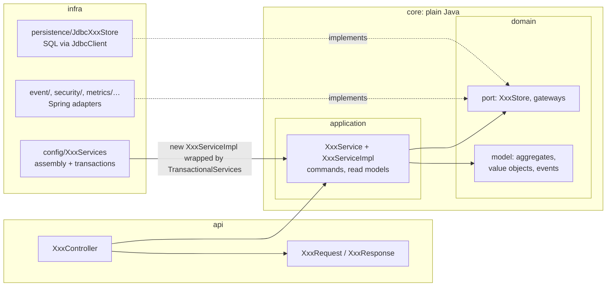

What `ArchitectureTest` enforces in CI for the green modules:

- `domain` and `application` import no Spring, JPA, servlet, Hibernate or Micrometer, and nothing from their own `api` or `infra`;
- nobody outside a module touches its `domain.port` or `infra`;
- no persistence framework anywhere (plain SQL only);
- no cycle between the parts of a domain, and none between modules;
- `shared` never reaches into a module's `infra` or `api`;
- no module's `domain` depends on any `api` package.

## 6. Authentication

Two transports coexist, and the frontend never sends both at once (`services/http.ts`).

```mermaid
sequenceDiagram
    autonumber
    actor U as Member
    participant SPA as SPA (browser)
    participant API as backend
    participant DB as PostgreSQL
    participant KC as Keycloak

    rect rgb(30, 45, 35)
    note over U,DB: Local account: email + password, server session
    U->>SPA: email + password
    SPA->>API: POST /api/auth/login (credentials: include)
    API->>DB: load account, BCrypt check
    API->>DB: create row in spring_session
    API-->>SPA: 200 + Set-Cookie SESSION (HttpOnly, Secure, SameSite=Lax, 30 days)
    SPA->>API: later calls carry the cookie
    end

    rect rgb(45, 35, 25)
    note over U,KC: Google or GitHub through Keycloak (OIDC + PKCE)
    U->>SPA: "Continuer avec Google"
    SPA->>KC: redirect, authorization code + PKCE
    KC-->>SPA: /auth/callback with code, then access token
    SPA->>API: POST /api/oidc/sync (Authorization: Bearer)
    API->>KC: fetch JWKS (cached), verify signature and issuer
    API->>DB: find or create the local account + identity link
    SPA->>API: later calls carry the bearer token, never the cookie
    end
```

Writes with the cookie are protected without a CSRF token: `SameSite=Lax` stops other sites
from sending it, and the CORS filter answers 403 to any `Origin` outside `CORS_ORIGINS`, other
`lescracks.com` subdomains included (asserted in `SecurityConfigTest`). Admin routes are locked
twice: the `/api/admin/**` and `/api/*/admin/**` matchers in `SecurityConfig`, and
`@PreAuthorize` on each method.

## 7. Key flows

### Sign-up: one module decides, the others react to an event

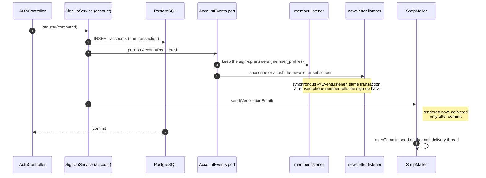

### Scheduled publication

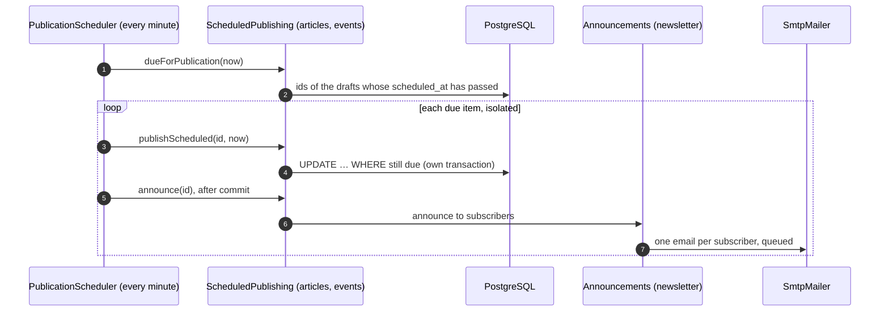

A failure on one item is logged and never blocks the others; a failing mail server never
unpublishes content.

### SEO snapshot for a bot

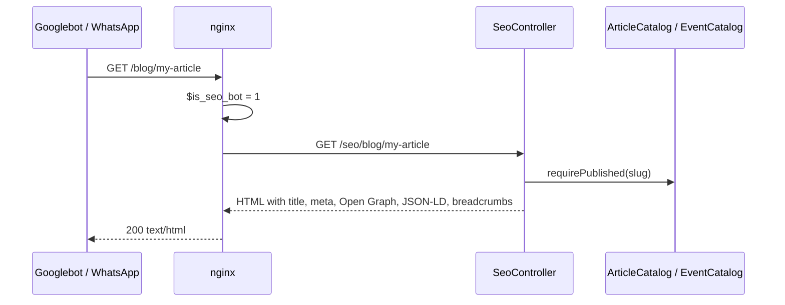

## 8. Data model

The essentials below; **every table, column, type, constraint and index** is in
[database.md](database.md) (one diagram per module plus a data dictionary) and
[schema.sql](schema.sql). Only keys and the columns that explain a relationship are shown here. `target_type` + `target_id` is a **polymorphic** reference
(`ARTICLE`, `EVENT`, `TALK`): it has no foreign key, by design (one engagement table for
every kind of content).

```mermaid
erDiagram
    accounts ||--o| member_profiles : "has (account_id PK)"
    accounts ||--o{ member_interests : chooses
    accounts ||--o{ account_identities : "links Google/GitHub"
    accounts ||--o{ account_tokens : "verification, reset"
    accounts |o--o| newsletter_subscribers : "may be (account_id)"
    categories ||--o{ member_interests : ""
    categories ||--o{ articles : "theme (category_id)"
    articles ||--o{ article_tags : ""
    tags ||--o{ article_tags : ""
    events ||--o{ event_registrations : ""
    accounts ||--o{ event_registrations : "user_id"
    events ||--o{ event_submissions : ""
    accounts ||--o{ event_submissions : "owner_id"
    event_submissions ||--o{ event_submission_members : team
    accounts ||--o{ event_submission_members : "user_id"
    badges ||--o{ member_badges : ""
    accounts ||--o{ member_badges : "user_id"
    accounts ||--o{ certificates : "user_id"
    events |o--o{ certificates : "event_id, nullable"
    accounts ||--o{ comments : "author_id"
    comments |o--o{ comments : "parent_id (replies)"
    comments ||--o{ comment_reports : ""
    accounts ||--o{ comment_reports : "reporter_id"
    accounts ||--o{ content_likes : "account_id"

    accounts {
        bigint id PK
        varchar email UK "lower(email)"
        varchar password_hash "null for OIDC-only"
        varchar status
        boolean email_verified
        timestamptz last_seen_at
        varchar signup_source
    }
    admins {
        bigint id PK
        varchar username UK
        varchar password_hash
        varchar status
    }
    member_profiles {
        bigint account_id PK, FK
        varchar username
        varchar country
        varchar situation
        varchar goal
        timestamptz onboarded_at
    }
    newsletter_subscribers {
        bigint id PK
        bigint account_id FK "nullable"
        varchar email UK
        varchar status
        varchar token UK
    }
    newsletter_campaigns {
        bigint id PK
        varchar subject
        int recipient_count
        timestamptz sent_at
    }
    articles {
        bigint id PK
        varchar slug UK
        bigint category_id FK
        varchar status
        timestamptz scheduled_at
        timestamptz published_at
        jsonb body "blocks"
    }
    talk_videos {
        bigint id PK
        varchar youtube_url
        varchar status
        timestamptz published_at
    }
    events {
        bigint id PK
        varchar slug UK
        varchar type
        varchar format
        timestamptz start_date
        varchar status
        boolean accepts_submissions
        int registration_count
    }
    event_submissions {
        bigint id PK
        bigint event_id FK
        bigint owner_id FK
        varchar status
        int score
    }
    certificates {
        bigint id PK
        varchar code UK "public check"
        bigint user_id FK
        bigint event_id FK
        varchar kind
        varchar status
    }
    comments {
        bigint id PK
        varchar target_type "polymorphic"
        bigint target_id "polymorphic"
        bigint author_id FK
        bigint parent_id FK
        varchar status
        int report_count
    }
    content_views {
        varchar target_type PK
        bigint target_id PK
        varchar visitor_key PK
    }
    content_likes {
        varchar target_type PK
        bigint target_id PK
        bigint account_id PK, FK
    }
    engagement_counters {
        varchar target_type PK
        bigint target_id PK
        bigint view_count
    }
```

## 9. Frontend

React 18 + Vite + TypeScript + Tailwind, served as static files by nginx. Only the landing
page, the sign-in pages and the 404 are in the first bundle; every other page and the whole
back office load on demand (`React.lazy`).

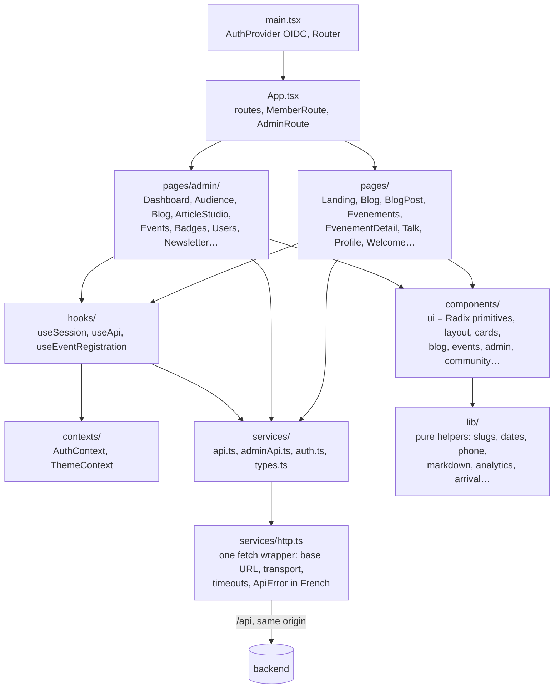

Rules that hold today (measured): no `fetch` outside `services/`, no `any`, no deep relative
import, one `ApiError` shape mirrored from the backend.

## 10. Delivery pipeline

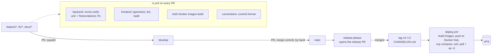

A rollback is a manual run of `deploy.yml` with an earlier tag.

## 11. Observability

| Signal | Source | Stored in | Seen in |
| --- | --- | --- | --- |
| API metrics (HTTP, JVM, sign-ins) | `/actuator/prometheus` on port 9090 | Prometheus (15 days) | Grafana |
| Database, host, containers | postgres-exporter, node-exporter, cAdvisor | Prometheus | Grafana |
| Public reachability | blackbox exporter probes | Prometheus | Grafana alerts (`monitoring/prometheus-rules.yml`) |
| Backend logs | `/var/log/lescracks/app.log` via Promtail | Loki | Grafana |
| Audience (visits, sources) | Umami script injected by nginx | Umami database | Umami, and the admin Audience page |
