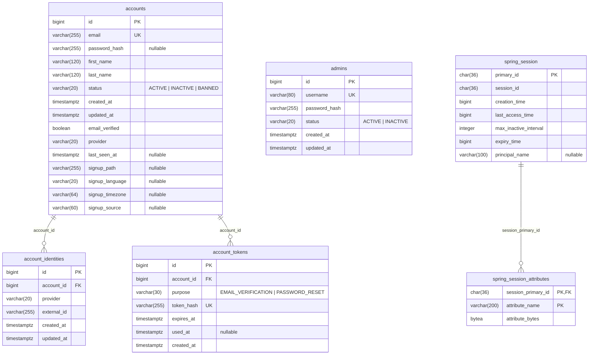
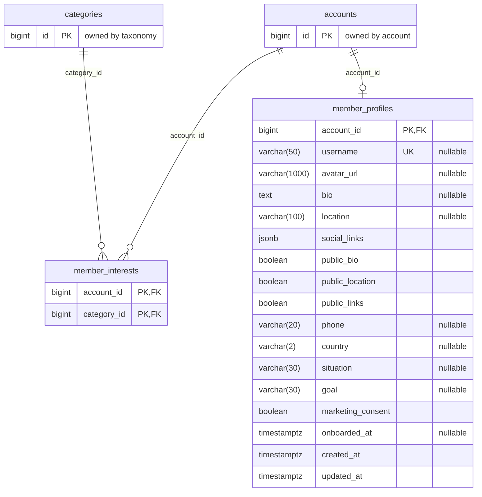
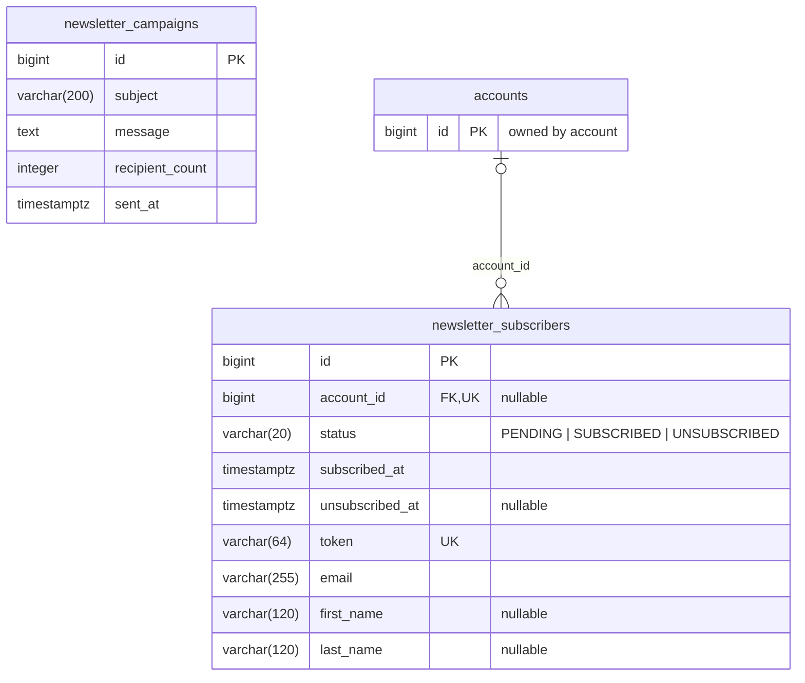
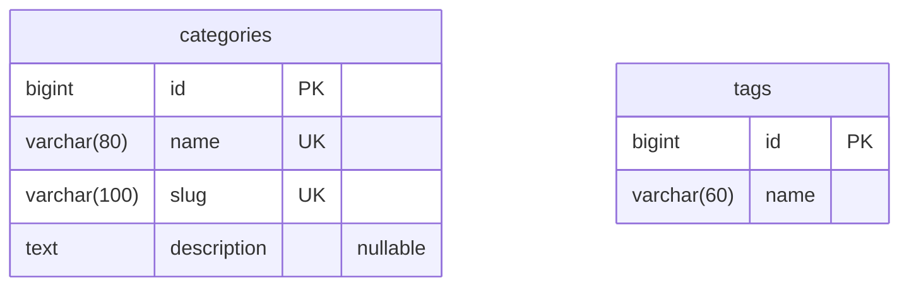
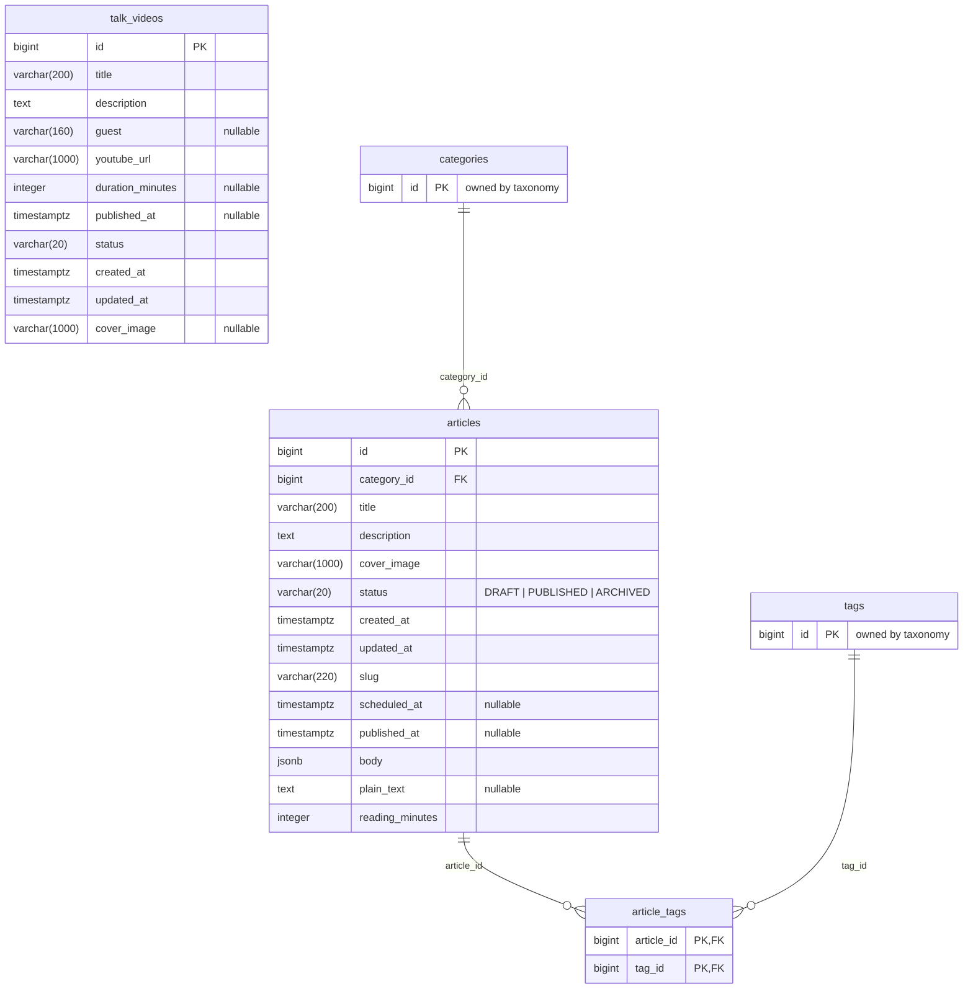
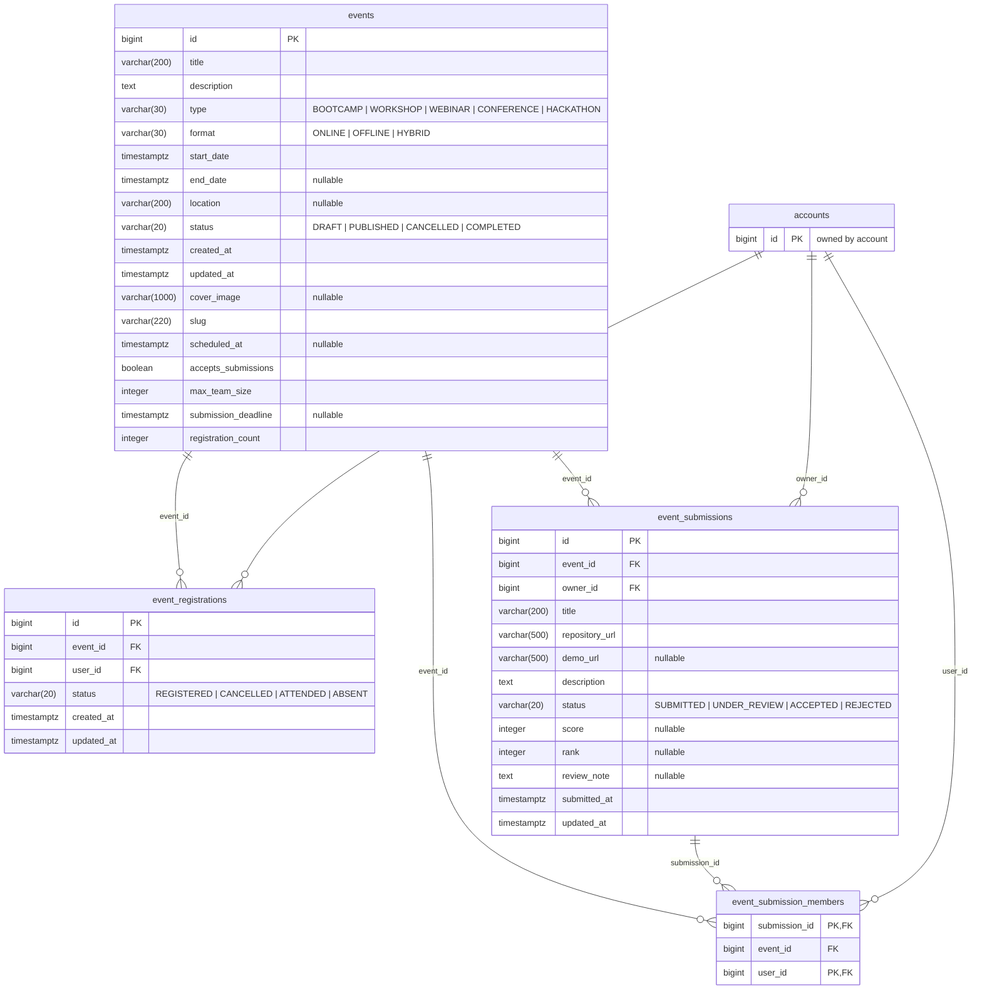
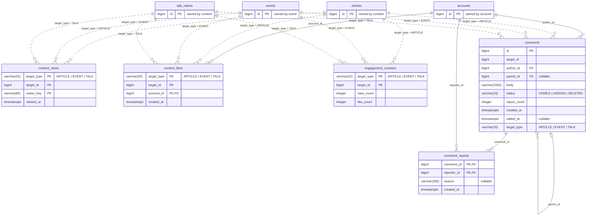
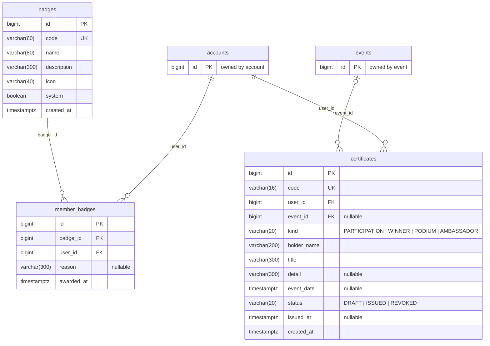
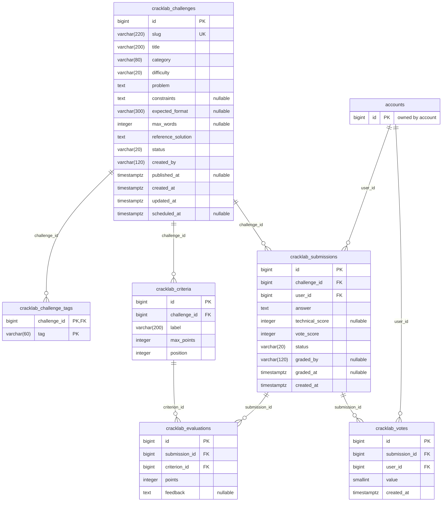

# Database schema

The complete PostgreSQL schema as Flyway builds it: all 33 tables, 243 columns, 34 foreign keys, 25 check constraints and 100 indexes, after `V40__index_member_foreign_keys.sql`.

Generated by replaying every migration of `backend/src/main/resources/db/migration` on an empty PostgreSQL
and reading its catalog, so it is the schema itself, not a description of it. The plain DDL is in
[schema.sql](schema.sql). The migrations stay the only source of truth: never change the database from these files.

- [Overview](#overview)
- [account](#account)
- [member](#member)
- [newsletter](#newsletter)
- [taxonomy](#taxonomy)
- [content](#content)
- [event](#event)
- [engagement](#engagement)
- [recognition](#recognition)
- [unused (CrackLab, removed)](#unused-cracklab-removed)
- [Conventions and anomalies](#conventions-and-anomalies)
- [Regenerating](#regenerating)

## Overview

| Module | Tables | Columns |
| --- | --- | ---: |
| account | `accounts`, `account_identities`, `account_tokens`, `admins`, `spring_session`, `spring_session_attributes` | 44 |
| member | `member_profiles`, `member_interests` | 19 |
| newsletter | `newsletter_subscribers`, `newsletter_campaigns` | 14 |
| taxonomy | `categories`, `tags` | 6 |
| content | `articles`, `article_tags`, `talk_videos` | 27 |
| event | `events`, `event_registrations`, `event_submissions`, `event_submission_members` | 40 |
| engagement | `content_views`, `content_likes`, `engagement_counters`, `comments`, `comment_reports` | 26 |
| recognition | `badges`, `member_badges`, `certificates` | 24 |
| unused (CrackLab, removed) | `cracklab_challenge_tags`, `cracklab_challenges`, `cracklab_criteria`, `cracklab_evaluations`, `cracklab_submissions`, `cracklab_votes` | 43 |

Every foreign key between the live tables. Solid lines are real foreign keys; dotted lines are the
polymorphic `target_type` + `target_id` references of the engagement tables, which have none.
`accounts` is the hub: almost every table that belongs to a person points to it, with `ON DELETE CASCADE`.

```mermaid
erDiagram
    admins {
        bigint id PK
    }
    newsletter_campaigns {
        bigint id PK
    }
    talk_videos {
        bigint id PK
    }
    accounts ||--o{ account_identities : "account_id"
    accounts ||--o{ account_tokens : "account_id"
    articles ||--o{ article_tags : "article_id"
    tags ||--o{ article_tags : "tag_id"
    categories ||--o{ articles : "category_id"
    events |o--o{ certificates : "event_id"
    accounts ||--o{ certificates : "user_id"
    comments ||--o{ comment_reports : "comment_id"
    accounts ||--o{ comment_reports : "reporter_id"
    accounts ||--o{ comments : "author_id"
    comments |o--o{ comments : "parent_id"
    accounts ||--o{ content_likes : "account_id"
    events ||--o{ event_registrations : "event_id"
    accounts ||--o{ event_registrations : "user_id"
    events ||--o{ event_submission_members : "event_id"
    event_submissions ||--o{ event_submission_members : "submission_id"
    accounts ||--o{ event_submission_members : "user_id"
    events ||--o{ event_submissions : "event_id"
    accounts ||--o{ event_submissions : "owner_id"
    badges ||--o{ member_badges : "badge_id"
    accounts ||--o{ member_badges : "user_id"
    categories ||--o{ member_interests : "category_id"
    accounts ||--o{ member_interests : "account_id"
    accounts ||--o| member_profiles : "account_id"
    accounts |o--o{ newsletter_subscribers : "account_id"
    spring_session ||--o{ spring_session_attributes : "session_primary_id"
    articles ||..o{ comments : "target"
    events ||..o{ comments : "target"
    talk_videos ||..o{ comments : "target"
    articles ||..o{ content_likes : "target"
    events ||..o{ content_likes : "target"
    talk_videos ||..o{ content_likes : "target"
    articles ||..o{ content_views : "target"
    events ||..o{ content_views : "target"
    talk_videos ||..o{ content_views : "target"
    articles ||..o{ engagement_counters : "target"
    events ||..o{ engagement_counters : "target"
    talk_videos ||..o{ engagement_counters : "target"
```



Each module below draws its own tables in full, the tables they reference as stubs (key only), and
the foreign keys it declares. Tables that point at a module appear in their own module's diagram.

## account

Sign-in: accounts, linked Google/GitHub identities, one-time tokens, back-office admins, server sessions.



#### `accounts`

| Column | Type | Null | Default | Key / reference |
| --- | --- | :---: | --- | --- |
| `id` | bigint | no | `auto (sequence)` | PK |
| `email` | varchar(255) | no |  | unique |
| `password_hash` | varchar(255) | yes |  |  |
| `first_name` | varchar(120) | no |  |  |
| `last_name` | varchar(120) | no |  |  |
| `status` | varchar(20) | no |  |  |
| `created_at` | timestamptz | no | `now()` |  |
| `updated_at` | timestamptz | no | `now()` |  |
| `email_verified` | boolean | no | `false` |  |
| `provider` | varchar(20) | no | `'LOCAL'` |  |
| `last_seen_at` | timestamptz | yes |  |  |
| `signup_path` | varchar(255) | yes |  |  |
| `signup_language` | varchar(20) | yes |  |  |
| `signup_timezone` | varchar(64) | yes |  |  |
| `signup_source` | varchar(60) | yes |  |  |

Constraints

- Check: `status` ∈ {ACTIVE, INACTIVE, BANNED}

Indexes (besides primary and unique keys)

- `accounts_created_at_idx`: (created_at DESC)
- `accounts_email_lower_idx`: (lower((email)::text))
- `accounts_last_seen_at_idx`: (last_seen_at)

#### `account_identities`

| Column | Type | Null | Default | Key / reference |
| --- | --- | :---: | --- | --- |
| `id` | bigint | no | `auto (sequence)` | PK |
| `account_id` | bigint | no |  | → `accounts` (on delete cascade) |
| `provider` | varchar(20) | no |  |  |
| `external_id` | varchar(255) | no |  |  |
| `created_at` | timestamptz | no | `now()` |  |
| `updated_at` | timestamptz | no | `now()` |  |

Constraints

- Unique: (`provider`, `external_id`)

Indexes (besides primary and unique keys)

- `account_identities_account_idx`: (account_id)

#### `account_tokens`

| Column | Type | Null | Default | Key / reference |
| --- | --- | :---: | --- | --- |
| `id` | bigint | no | `auto (sequence)` | PK |
| `account_id` | bigint | no |  | → `accounts` (on delete cascade) |
| `purpose` | varchar(30) | no |  |  |
| `token_hash` | varchar(255) | no |  | unique |
| `expires_at` | timestamptz | no |  |  |
| `used_at` | timestamptz | yes |  |  |
| `created_at` | timestamptz | no | `now()` |  |

Constraints

- Check: `purpose` ∈ {EMAIL_VERIFICATION, PASSWORD_RESET}

Indexes (besides primary and unique keys)

- `account_tokens_latest_idx`: (account_id, purpose, created_at DESC)

#### `admins`

| Column | Type | Null | Default | Key / reference |
| --- | --- | :---: | --- | --- |
| `id` | bigint | no | `auto (sequence)` | PK |
| `username` | varchar(80) | no |  | unique |
| `password_hash` | varchar(255) | no |  |  |
| `status` | varchar(20) | no |  |  |
| `created_at` | timestamptz | no | `now()` |  |
| `updated_at` | timestamptz | no | `now()` |  |

Constraints

- Check: `status` ∈ {ACTIVE, INACTIVE}

Indexes (besides primary and unique keys)

- `admins_username_lower_idx`: (lower((username)::text))

#### `spring_session`

| Column | Type | Null | Default | Key / reference |
| --- | --- | :---: | --- | --- |
| `primary_id` | char(36) | no |  | PK |
| `session_id` | char(36) | no |  |  |
| `creation_time` | bigint | no |  |  |
| `last_access_time` | bigint | no |  |  |
| `max_inactive_interval` | integer | no |  |  |
| `expiry_time` | bigint | no |  |  |
| `principal_name` | varchar(100) | yes |  |  |

Indexes (besides primary and unique keys)

- `spring_session_ix1`: unique (session_id)
- `spring_session_ix2`: (expiry_time)
- `spring_session_ix3`: (principal_name)

#### `spring_session_attributes`

| Column | Type | Null | Default | Key / reference |
| --- | --- | :---: | --- | --- |
| `session_primary_id` | char(36) | no |  | PK, → `spring_session` (on delete cascade) |
| `attribute_name` | varchar(200) | no |  | PK |
| `attribute_bytes` | bytea | no |  |  |

Constraints

- Primary key: (`session_primary_id`, `attribute_name`)

## member

Public profile and welcome answers of an account.



#### `member_profiles`

| Column | Type | Null | Default | Key / reference |
| --- | --- | :---: | --- | --- |
| `account_id` | bigint | no |  | PK, → `accounts` (on delete cascade) |
| `username` | varchar(50) | yes |  | unique |
| `avatar_url` | varchar(1000) | yes |  |  |
| `bio` | text | yes |  |  |
| `location` | varchar(100) | yes |  |  |
| `social_links` | jsonb | no | `'{}'` |  |
| `public_bio` | boolean | no | `false` |  |
| `public_location` | boolean | no | `false` |  |
| `public_links` | boolean | no | `false` |  |
| `phone` | varchar(20) | yes |  |  |
| `country` | varchar(2) | yes |  |  |
| `situation` | varchar(30) | yes |  |  |
| `goal` | varchar(30) | yes |  |  |
| `marketing_consent` | boolean | no | `false` |  |
| `onboarded_at` | timestamptz | yes |  |  |
| `created_at` | timestamptz | no | `now()` |  |
| `updated_at` | timestamptz | no | `now()` |  |

Indexes (besides primary and unique keys)

- `member_profiles_country_idx`: (country)
- `member_profiles_onboarded_at_idx`: (onboarded_at)

#### `member_interests`

| Column | Type | Null | Default | Key / reference |
| --- | --- | :---: | --- | --- |
| `account_id` | bigint | no |  | PK, → `accounts` (on delete cascade) |
| `category_id` | bigint | no |  | PK, → `categories` (on delete cascade) |

Constraints

- Primary key: (`account_id`, `category_id`)

Indexes (besides primary and unique keys)

- `member_interests_category_idx`: (category_id)

## newsletter

Subscribers (with or without an account) and sent campaigns.



#### `newsletter_subscribers`

| Column | Type | Null | Default | Key / reference |
| --- | --- | :---: | --- | --- |
| `id` | bigint | no | `auto (sequence)` | PK |
| `account_id` | bigint | yes |  | → `accounts` (on delete cascade), unique |
| `status` | varchar(20) | no |  |  |
| `subscribed_at` | timestamptz | no | `now()` |  |
| `unsubscribed_at` | timestamptz | yes |  |  |
| `token` | varchar(64) | no |  | unique |
| `email` | varchar(255) | no |  |  |
| `first_name` | varchar(120) | yes |  |  |
| `last_name` | varchar(120) | yes |  |  |

Constraints

- Check: `status` ∈ {PENDING, SUBSCRIBED, UNSUBSCRIBED}

Indexes (besides primary and unique keys)

- `newsletter_subscribers_email_key`: unique (lower((email)::text))
- `newsletter_subscribers_status_idx`: (status)
- `newsletter_subscribers_subscribed_at_idx`: (subscribed_at)

#### `newsletter_campaigns`

| Column | Type | Null | Default | Key / reference |
| --- | --- | :---: | --- | --- |
| `id` | bigint | no | `auto (sequence)` | PK |
| `subject` | varchar(200) | no |  |  |
| `message` | text | no |  |  |
| `recipient_count` | integer | no |  |  |
| `sent_at` | timestamptz | no |  |  |

## taxonomy

Themes (table `categories`) and flat tags.



#### `categories`

| Column | Type | Null | Default | Key / reference |
| --- | --- | :---: | --- | --- |
| `id` | bigint | no | `auto (sequence)` | PK |
| `name` | varchar(80) | no |  | unique |
| `slug` | varchar(100) | no |  | unique |
| `description` | text | yes |  |  |

#### `tags`

| Column | Type | Null | Default | Key / reference |
| --- | --- | :---: | --- | --- |
| `id` | bigint | no | `auto (sequence)` | PK |
| `name` | varchar(60) | no |  |  |

Indexes (besides primary and unique keys)

- `tags_name_unique`: unique (lower((name)::text))

## content

Blog articles and their tags, Talk episodes.



#### `articles`

| Column | Type | Null | Default | Key / reference |
| --- | --- | :---: | --- | --- |
| `id` | bigint | no | `auto (sequence)` | PK |
| `category_id` | bigint | no |  | → `categories` (on delete restrict) |
| `title` | varchar(200) | no |  |  |
| `description` | text | no |  |  |
| `cover_image` | varchar(1000) | no |  |  |
| `status` | varchar(20) | no |  |  |
| `created_at` | timestamptz | no | `now()` |  |
| `updated_at` | timestamptz | no | `now()` |  |
| `slug` | varchar(220) | no |  |  |
| `scheduled_at` | timestamptz | yes |  |  |
| `published_at` | timestamptz | yes |  |  |
| `body` | jsonb | no |  |  |
| `plain_text` | text | yes |  |  |
| `reading_minutes` | integer | no | `1` |  |

Constraints

- Check: `status` ∈ {DRAFT, PUBLISHED, ARCHIVED}

Indexes (besides primary and unique keys)

- `articles_catalogue_idx`: (status, COALESCE(published_at, created_at) DESC)
- `articles_category_idx`: (category_id)
- `articles_scheduled_at_idx`: (scheduled_at) WHERE (scheduled_at IS NOT NULL)
- `articles_slug_idx`: (slug)
- `articles_status_idx`: (status)

#### `article_tags`

| Column | Type | Null | Default | Key / reference |
| --- | --- | :---: | --- | --- |
| `article_id` | bigint | no |  | PK, → `articles` (on delete cascade) |
| `tag_id` | bigint | no |  | PK, → `tags` (on delete cascade) |

Constraints

- Primary key: (`article_id`, `tag_id`)

Indexes (besides primary and unique keys)

- `article_tags_tag_idx`: (tag_id)

#### `talk_videos`

| Column | Type | Null | Default | Key / reference |
| --- | --- | :---: | --- | --- |
| `id` | bigint | no | `auto (sequence)` | PK |
| `title` | varchar(200) | no |  |  |
| `description` | text | no |  |  |
| `guest` | varchar(160) | yes |  |  |
| `youtube_url` | varchar(1000) | no |  |  |
| `duration_minutes` | integer | yes |  |  |
| `published_at` | timestamptz | yes |  |  |
| `status` | varchar(20) | no | `'DRAFT'` |  |
| `created_at` | timestamptz | no | `now()` |  |
| `updated_at` | timestamptz | no | `now()` |  |
| `cover_image` | varchar(1000) | yes |  |  |

Indexes (besides primary and unique keys)

- `idx_talk_videos_status_published_at`: (status, published_at DESC NULLS LAST)

## event

Events, registrations, hackathon projects and their teams.



#### `events`

| Column | Type | Null | Default | Key / reference |
| --- | --- | :---: | --- | --- |
| `id` | bigint | no | `auto (sequence)` | PK |
| `title` | varchar(200) | no |  |  |
| `description` | text | no |  |  |
| `type` | varchar(30) | no |  |  |
| `format` | varchar(30) | no |  |  |
| `start_date` | timestamptz | no |  |  |
| `end_date` | timestamptz | yes |  |  |
| `location` | varchar(200) | yes |  |  |
| `status` | varchar(20) | no |  |  |
| `created_at` | timestamptz | no | `now()` |  |
| `updated_at` | timestamptz | no | `now()` |  |
| `cover_image` | varchar(1000) | yes |  |  |
| `slug` | varchar(220) | no |  |  |
| `scheduled_at` | timestamptz | yes |  |  |
| `accepts_submissions` | boolean | no | `false` |  |
| `max_team_size` | integer | no | `1` |  |
| `submission_deadline` | timestamptz | yes |  |  |
| `registration_count` | integer | no | `0` |  |

Constraints

- Check: `(((end_date IS NULL) OR (end_date >= start_date)))`
- Check: `format` ∈ {ONLINE, OFFLINE, HYBRID}
- Check: `status` ∈ {DRAFT, PUBLISHED, CANCELLED, COMPLETED}
- Check: `(((max_team_size >= 1) AND (max_team_size <= 4)))`
- Check: `type` ∈ {BOOTCAMP, WORKSHOP, WEBINAR, CONFERENCE, HACKATHON}

Indexes (besides primary and unique keys)

- `events_catalogue_idx`: (status, start_date)
- `events_start_date_idx`: (start_date DESC)
- `events_status_idx`: (status)
- `events_type_idx`: (type)
- `idx_event_slug`: (slug)
- `idx_events_scheduled_at`: (scheduled_at) WHERE (scheduled_at IS NOT NULL)

#### `event_registrations`

| Column | Type | Null | Default | Key / reference |
| --- | --- | :---: | --- | --- |
| `id` | bigint | no | `auto (sequence)` | PK |
| `event_id` | bigint | no |  | → `events` (on delete cascade) |
| `user_id` | bigint | no |  | → `accounts` (on delete cascade) |
| `status` | varchar(20) | no | `'REGISTERED'` |  |
| `created_at` | timestamptz | no | `now()` |  |
| `updated_at` | timestamptz | no | `now()` |  |

Constraints

- Unique: (`event_id`, `user_id`)
- Check: `status` ∈ {REGISTERED, CANCELLED, ATTENDED, ABSENT}

Indexes (besides primary and unique keys)

- `event_registrations_user_idx`: (user_id)

#### `event_submissions`

| Column | Type | Null | Default | Key / reference |
| --- | --- | :---: | --- | --- |
| `id` | bigint | no | `auto (sequence)` | PK |
| `event_id` | bigint | no |  | → `events` (on delete cascade) |
| `owner_id` | bigint | no |  | → `accounts` (on delete cascade) |
| `title` | varchar(200) | no |  |  |
| `repository_url` | varchar(500) | no |  |  |
| `demo_url` | varchar(500) | yes |  |  |
| `description` | text | no |  |  |
| `status` | varchar(20) | no | `'SUBMITTED'` |  |
| `score` | integer | yes |  |  |
| `rank` | integer | yes |  |  |
| `review_note` | text | yes |  |  |
| `submitted_at` | timestamptz | no | `now()` |  |
| `updated_at` | timestamptz | no | `now()` |  |

Constraints

- Check: `(((rank IS NULL) OR ((rank >= 1) AND (rank <= 10))))`
- Check: `(((score IS NULL) OR ((score >= 0) AND (score <= 100))))`
- Check: `status` ∈ {SUBMITTED, UNDER_REVIEW, ACCEPTED, REJECTED}

Indexes (besides primary and unique keys)

- `event_submissions_event_idx`: (event_id)
- `event_submissions_owner_idx`: (owner_id)

#### `event_submission_members`

| Column | Type | Null | Default | Key / reference |
| --- | --- | :---: | --- | --- |
| `submission_id` | bigint | no |  | PK, → `event_submissions` (on delete cascade) |
| `event_id` | bigint | no |  | → `events` (on delete cascade) |
| `user_id` | bigint | no |  | PK, → `accounts` (on delete cascade) |

Constraints

- Primary key: (`submission_id`, `user_id`)
- Unique: (`event_id`, `user_id`)

Indexes (besides primary and unique keys)

- `event_submission_members_user_idx`: (user_id)

## engagement

Views, likes, view counters, comments and reports on any content (polymorphic target).



#### `content_views`

| Column | Type | Null | Default | Key / reference |
| --- | --- | :---: | --- | --- |
| `target_type` | varchar(20) | no |  | PK |
| `target_id` | bigint | no |  | PK |
| `visitor_key` | varchar(80) | no |  | PK |
| `viewed_at` | timestamptz | no | `now()` |  |

Constraints

- Primary key: (`target_type`, `target_id`, `visitor_key`)
- Check: `target_type` ∈ {ARTICLE, EVENT, TALK}
- `target_type` + `target_id` point to `articles`, `events` or `talk_videos`; no foreign key by design, the engagement module checks the target through `ContentTargets`

#### `content_likes`

| Column | Type | Null | Default | Key / reference |
| --- | --- | :---: | --- | --- |
| `target_type` | varchar(20) | no |  | PK |
| `target_id` | bigint | no |  | PK |
| `account_id` | bigint | no |  | PK, → `accounts` (on delete cascade) |
| `created_at` | timestamptz | no | `now()` |  |

Constraints

- Primary key: (`target_type`, `target_id`, `account_id`)
- Check: `target_type` ∈ {ARTICLE, EVENT, TALK}
- `target_type` + `target_id` point to `articles`, `events` or `talk_videos`; no foreign key by design, the engagement module checks the target through `ContentTargets`

Indexes (besides primary and unique keys)

- `content_likes_account_idx`: (account_id)

#### `engagement_counters`

| Column | Type | Null | Default | Key / reference |
| --- | --- | :---: | --- | --- |
| `target_type` | varchar(20) | no |  | PK |
| `target_id` | bigint | no |  | PK |
| `view_count` | integer | no | `0` |  |
| `like_count` | integer | no | `0` |  |

Constraints

- Primary key: (`target_type`, `target_id`)
- Check: `target_type` ∈ {ARTICLE, EVENT, TALK}
- `target_type` + `target_id` point to `articles`, `events` or `talk_videos`; no foreign key by design, the engagement module checks the target through `ContentTargets`

#### `comments`

| Column | Type | Null | Default | Key / reference |
| --- | --- | :---: | --- | --- |
| `id` | bigint | no | `auto (sequence)` | PK |
| `target_id` | bigint | no |  |  |
| `author_id` | bigint | no |  | → `accounts` (on delete cascade) |
| `parent_id` | bigint | yes |  | → `comments` (on delete cascade) |
| `body` | varchar(2000) | no |  |  |
| `status` | varchar(20) | no | `'VISIBLE'` |  |
| `report_count` | integer | no | `0` |  |
| `created_at` | timestamptz | no | `now()` |  |
| `edited_at` | timestamptz | yes |  |  |
| `target_type` | varchar(20) | no |  |  |

Constraints

- Check: `status` ∈ {VISIBLE, HIDDEN, DELETED}
- Check: `target_type` ∈ {ARTICLE, EVENT, TALK}
- `target_type` + `target_id` point to `articles`, `events` or `talk_videos`; no foreign key by design, the engagement module checks the target through `ContentTargets`

Indexes (besides primary and unique keys)

- `comments_author_idx`: (author_id, created_at)
- `comments_moderation_idx`: (report_count, created_at) WHERE ((status)::text <> 'DELETED'::text)
- `comments_parent_idx`: (parent_id)
- `comments_target_idx`: (target_type, target_id, created_at)

#### `comment_reports`

| Column | Type | Null | Default | Key / reference |
| --- | --- | :---: | --- | --- |
| `comment_id` | bigint | no |  | PK, → `comments` (on delete cascade) |
| `reporter_id` | bigint | no |  | PK, → `accounts` (on delete cascade) |
| `reason` | varchar(300) | yes |  |  |
| `created_at` | timestamptz | no | `now()` |  |

Constraints

- Primary key: (`comment_id`, `reporter_id`)

Indexes (besides primary and unique keys)

- `comment_reports_comment_idx`: (comment_id, created_at)
- `comment_reports_reporter_idx`: (reporter_id)

## recognition

Badges, badges awarded to members, certificates.



#### `badges`

| Column | Type | Null | Default | Key / reference |
| --- | --- | :---: | --- | --- |
| `id` | bigint | no | `auto (sequence)` | PK |
| `code` | varchar(60) | no |  | unique |
| `name` | varchar(80) | no |  |  |
| `description` | varchar(300) | no |  |  |
| `icon` | varchar(40) | no | `'award'` |  |
| `system` | boolean | no | `false` |  |
| `created_at` | timestamptz | no | `now()` |  |

#### `member_badges`

| Column | Type | Null | Default | Key / reference |
| --- | --- | :---: | --- | --- |
| `id` | bigint | no | `auto (sequence)` | PK |
| `badge_id` | bigint | no |  | → `badges` (on delete cascade) |
| `user_id` | bigint | no |  | → `accounts` (on delete cascade) |
| `reason` | varchar(300) | yes |  |  |
| `awarded_at` | timestamptz | no | `now()` |  |

Constraints

- Unique: (`badge_id`, `user_id`)

Indexes (besides primary and unique keys)

- `member_badges_user_idx`: (user_id)

#### `certificates`

| Column | Type | Null | Default | Key / reference |
| --- | --- | :---: | --- | --- |
| `id` | bigint | no | `auto (sequence)` | PK |
| `code` | varchar(16) | no |  | unique |
| `user_id` | bigint | no |  | → `accounts` (on delete cascade) |
| `event_id` | bigint | yes |  | → `events` (on delete set null) |
| `kind` | varchar(20) | no |  |  |
| `holder_name` | varchar(200) | no |  |  |
| `title` | varchar(300) | no |  |  |
| `detail` | varchar(300) | yes |  |  |
| `event_date` | timestamptz | yes |  |  |
| `status` | varchar(20) | no | `'DRAFT'` |  |
| `issued_at` | timestamptz | yes |  |  |
| `created_at` | timestamptz | no | `now()` |  |

Constraints

- Unique: (`user_id`, `event_id`, `kind`)
- Check: `kind` ∈ {PARTICIPATION, WINNER, PODIUM, AMBASSADOR}
- Check: `status` ∈ {DRAFT, ISSUED, REVOKED}

Indexes (besides primary and unique keys)

- `certificates_event_idx`: (event_id)
- `certificates_user_idx`: (user_id)

## unused (CrackLab, removed)

Kept on purpose, read by no code.



#### `cracklab_challenge_tags`

| Column | Type | Null | Default | Key / reference |
| --- | --- | :---: | --- | --- |
| `challenge_id` | bigint | no |  | PK, → `cracklab_challenges` (on delete cascade) |
| `tag` | varchar(60) | no |  | PK |

Constraints

- Primary key: (`challenge_id`, `tag`)

#### `cracklab_challenges`

| Column | Type | Null | Default | Key / reference |
| --- | --- | :---: | --- | --- |
| `id` | bigint | no | `auto (sequence)` | PK |
| `slug` | varchar(220) | no |  | unique |
| `title` | varchar(200) | no |  |  |
| `category` | varchar(80) | no |  |  |
| `difficulty` | varchar(20) | no |  |  |
| `problem` | text | no |  |  |
| `constraints` | text | yes |  |  |
| `expected_format` | varchar(300) | yes |  |  |
| `max_words` | integer | yes |  |  |
| `reference_solution` | text | no |  |  |
| `status` | varchar(20) | no | `'DRAFT'` |  |
| `created_by` | varchar(120) | no |  |  |
| `published_at` | timestamptz | yes |  |  |
| `created_at` | timestamptz | no | `now()` |  |
| `updated_at` | timestamptz | no | `now()` |  |
| `scheduled_at` | timestamptz | yes |  |  |

Constraints

- Check: `(((max_words IS NULL) OR (max_words > 0)))`

Indexes (besides primary and unique keys)

- `idx_cracklab_challenges_scheduled_at`: (scheduled_at) WHERE (scheduled_at IS NOT NULL)
- `idx_cracklab_challenges_status`: (status)

#### `cracklab_criteria`

| Column | Type | Null | Default | Key / reference |
| --- | --- | :---: | --- | --- |
| `id` | bigint | no | `auto (sequence)` | PK |
| `challenge_id` | bigint | no |  | → `cracklab_challenges` (on delete cascade) |
| `label` | varchar(200) | no |  |  |
| `max_points` | integer | no |  |  |
| `position` | integer | no |  |  |

Constraints

- Check: `((max_points > 0))`

Indexes (besides primary and unique keys)

- `idx_cracklab_criteria_challenge`: (challenge_id)

#### `cracklab_evaluations`

| Column | Type | Null | Default | Key / reference |
| --- | --- | :---: | --- | --- |
| `id` | bigint | no | `auto (sequence)` | PK |
| `submission_id` | bigint | no |  | → `cracklab_submissions` (on delete cascade) |
| `criterion_id` | bigint | no |  | → `cracklab_criteria` (on delete cascade) |
| `points` | integer | no |  |  |
| `feedback` | text | yes |  |  |

Constraints

- Unique: (`submission_id`, `criterion_id`)
- Check: `((points >= 0))`

#### `cracklab_submissions`

| Column | Type | Null | Default | Key / reference |
| --- | --- | :---: | --- | --- |
| `id` | bigint | no | `auto (sequence)` | PK |
| `challenge_id` | bigint | no |  | → `cracklab_challenges` (on delete cascade) |
| `user_id` | bigint | no |  | → `accounts` (on delete cascade) |
| `answer` | text | no |  |  |
| `technical_score` | integer | yes |  |  |
| `vote_score` | integer | no | `0` |  |
| `status` | varchar(20) | no | `'SUBMITTED'` |  |
| `graded_by` | varchar(120) | yes |  |  |
| `graded_at` | timestamptz | yes |  |  |
| `created_at` | timestamptz | no | `now()` |  |

Constraints

- Unique: (`challenge_id`, `user_id`)

Indexes (besides primary and unique keys)

- `idx_cracklab_submissions_status`: (status)
- `idx_cracklab_submissions_user`: (user_id)

#### `cracklab_votes`

| Column | Type | Null | Default | Key / reference |
| --- | --- | :---: | --- | --- |
| `id` | bigint | no | `auto (sequence)` | PK |
| `submission_id` | bigint | no |  | → `cracklab_submissions` (on delete cascade) |
| `user_id` | bigint | no |  | → `accounts` (on delete cascade) |
| `value` | smallint | no |  |  |
| `created_at` | timestamptz | no | `now()` |  |

Constraints

- Unique: (`submission_id`, `user_id`)
- Check: `((value = ANY (ARRAY[-1, 1])))`

## Conventions and anomalies

What holds everywhere:

- Surrogate `bigint` ids from a sequence; link tables use a composite primary key.
- Every instant is `timestamptz`; every enum-like `status`/`type` column is a `varchar` guarded by a `CHECK`, except the one below.
- People are referenced by `accounts.id`, and deleting an account cascades to everything that belongs to it.
- Emails are unique case-insensitively (`lower(email)` indexes on `accounts` and `newsletter_subscribers`).

Found while generating this file (none blocks anything; each is a candidate for a later migration):

- `talk_videos.status` has no `CHECK`, unlike every other status column.
- Some sequences kept the name of the table they were created for before a rename: `user_identities_id_seq` (now `account_identities`), `newsletter_subscriptions_id_seq` (now `newsletter_subscribers`). Harmless, but confusing in a dump.
- `newsletter_subscribers.account_id` cascades: deleting an account deletes its subscription instead of keeping it as an anonymous subscriber. Fine for erasure requests, worth knowing.
- The polymorphic engagement tables cannot have a foreign key: a deleted article leaves its views, likes and comments behind unless the deleting use case removes them.
- The six `cracklab_*` tables are unused since CrackLab was removed.

## Regenerating

Any empty PostgreSQL with the migrations applied gives the same schema. With the dev stack:

```bash
docker compose up -d                 # postgres + minio
cd backend && ./mvnw spring-boot:run # Flyway applies every migration at startup
docker compose exec postgres pg_dump -U postgres -d lescracks --schema-only --no-owner > schema-dump.sql
```
